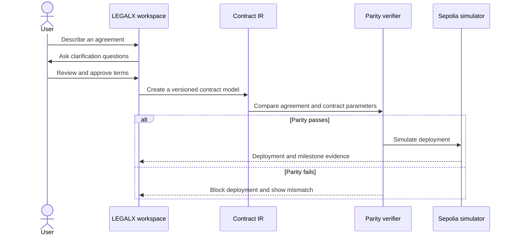
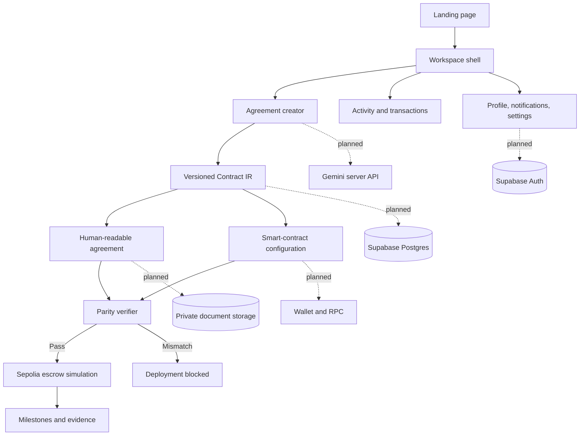
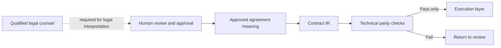

# LEGALX

### Understand agreements. Verify the code. Release with confidence.

LEGALX is a dark, mobile-first prototype for converting plain-language agreements into structured Contract IR, checking legal-to-code parity, and simulating milestone-based escrow execution on Sepolia.

> **Prototype disclaimer:** LEGALX provides drafting and verification assistance, not legal advice. Demo transactions are simulated and no real funds move.

---

## Contents

- [What LEGALX does](#what-legalx-does)
- [Prototype walkthrough](#prototype-walkthrough)
- [Core product surfaces](#core-product-surfaces)
- [Architecture](#architecture)
- [Repository structure](#repository-structure)
- [Run locally](#run-locally)
- [Test the prototype](#test-the-prototype)
- [Production readiness](#production-readiness)
- [Security boundary](#security-boundary)
- [Design principles](#design-principles)
- [License](#license)

## What LEGALX does

Most agreements are written for people, while software needs explicit rules. LEGALX creates a shared layer between the two:

1. A user describes the agreement in everyday language.
2. LEGALX clarifies missing terms and produces a versioned Contract IR.
3. The human-readable agreement and smart-contract configuration are generated from the same source.
4. A parity check compares the two representations before deployment.
5. Approved milestones can be simulated as escrow releases with evidence and an audit trail.

The result is a reviewable workflow where humans approve the meaning and software verifies consistency.

## Prototype walkthrough



## Core product surfaces

- **Landing page** — product narrative, trust boundary, proof points, and demo launch.
- **Agreement creator** — describe, clarify, review, generate, and verify an agreement.
- **Agreements** — versioned agreement workspace and review status.
- **Parity verification** — compare contract parameters, inspect diffs, and simulate tampering.
- **Smart contracts** — inspect deployment configuration and simulate a wallet connection.
- **Milestones** — move deliverables through pending, submitted, and released states.
- **Transactions** — review simulated chain events and evidence.
- **Activity** — inspect an immutable-style audit trail.
- **Notifications** — surface approvals, parity results, and review deadlines.
- **Profile and settings** — edit demo identity, notification preferences, environment mode, and integration readiness.

## Architecture



### Trust boundary



Technical verification can demonstrate that two representations match. It cannot determine whether an agreement is legally enforceable, fair, or appropriate for a specific jurisdiction.

## Repository structure

```text
.
├── app/
│   ├── page.tsx          # Landing page and workspace prototype
│   ├── globals.css       # Dark design system and responsive layout
│   └── layout.tsx        # App metadata and shell configuration
├── public/               # Static assets
├── README.md             # Product, architecture, setup, and readiness guide
├── package.json          # Scripts and dependencies
└── tsconfig.json         # TypeScript configuration
```

## Run locally

### Requirements

- Node.js 20+
- pnpm 9+

### Start the development server

```bash
pnpm install
pnpm dev
```

Then open [http://localhost:3000](http://localhost:3000).

### Useful commands

```bash
pnpm dev                 # Start Next.js in development mode
pnpm exec tsc --noEmit   # Run the TypeScript check
pnpm exec next lint      # Run linting when configured
```

## Test the prototype

No external credentials are required for the current demo.

1. Launch the application from the landing page.
2. Open **Agreements** and walk through the creator steps.
3. Open **Parity verification** and select **Simulate tampering**.
4. Confirm that the mismatch blocks the deployment path.
5. Restore the approved parameters and open **Smart contracts**.
6. Simulate wallet connection and deployment.
7. Open **Milestones** and move a milestone through **Pending → Submitted → Released**.
8. Visit **Transactions** and **Activity** to inspect the resulting evidence.
9. Open **Notifications**, **Profile**, and **Settings**.
10. Toggle each setting and integration switch, save the state, and verify the saved status.
11. Test the primary mobile viewport at **311 × 616** in dark mode.

## Production readiness

The current implementation is intentionally local and safe for prototyping. A production build should add the following behind server-side boundaries:

### Data and identity

- Supabase Auth with email/password, verified sessions, role checks, and protected routes.
- Supabase Postgres tables for workspaces, members, agreements, versions, fields, parity reports, deployments, milestones, and audit events.
- Row Level Security policies for every user-owned and workspace-owned table.
- Server-side validation for every mutation with schema validation and parameterized queries.
- Private document storage with signed URLs, versioning, malware scanning, and retention rules.

### AI and document processing

- Call Gemini only from a server route or server action.
- Store extracted fields with source references and confidence values.
- Require human approval before Contract IR becomes deployable.
- Keep prompts, model versions, extraction results, and corrections auditable.

### Blockchain and escrow

- Use a dedicated Sepolia deployment service; never expose private keys in the browser.
- Add explicit chain ID and wallet-network checks.
- Use a tested OpenZeppelin escrow contract with reentrancy protection, access control, pull-based releases, dispute pause, and emitted events.
- Index deployment and milestone events into the application audit trail.
- Add idempotency keys and confirmation handling for every transaction request.
- Keep production and demo environments completely separate.

### Operations

- Add error monitoring, structured logs, rate limits, backups, and alerting.
- Add automated unit, integration, contract, accessibility, and end-to-end tests.
- Add a formal legal review, jurisdiction policy, terms of service, and privacy policy.
- Use environment variables for all credentials and rotate secrets through the deployment platform.

## Security boundary

Never commit credentials, private keys, service-role keys, `.env` files, or raw user documents. The browser should receive only the minimum data required for the current view. Auth, AI, storage, database mutations, and blockchain signing/deployment belong on trusted server-side infrastructure.

For production, enforce:

- Authentication and workspace authorization on every protected action.
- RLS and server-side ownership checks.
- Strict input validation and output encoding.
- Audit events for approvals, edits, deployments, releases, and disputes.
- HTTPS, secure cookies, CSRF protection where applicable, and baseline security headers.

## Design principles

- **Evidence over confidence:** every important state should point to a record, diff, or event.
- **Human approval before execution:** automation prepares; people approve.
- **Fail closed:** parity mismatches block deployment instead of being silently ignored.
- **Clear trust boundaries:** technical verification is not legal advice.
- **Mobile first:** core review actions remain usable at narrow widths.
- **Calm interface:** restrained color, strong hierarchy, and progressive disclosure keep high-stakes workflows readable.

## License

This repository is a prototype and does not currently declare a production license. Add an explicit license before distributing or commercializing the code.
